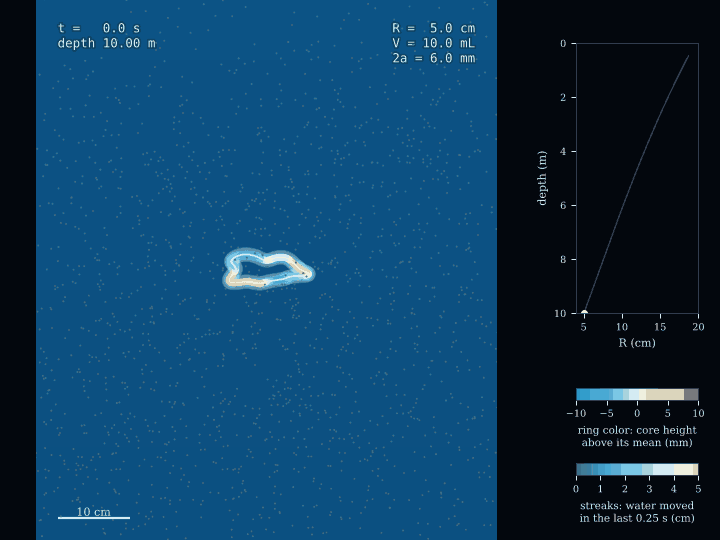
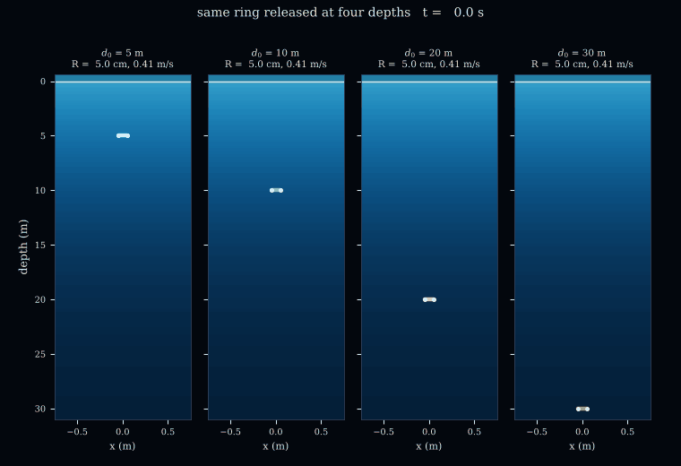
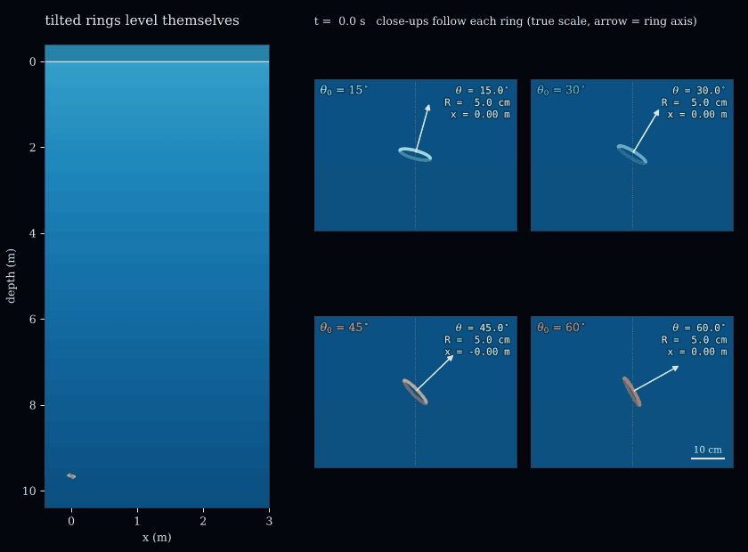

# Supplementary Materials "Decompression, self-leveling, and wobble decay of bubble rings released by scuba divers"

[](https://doi.org/10.5281/zenodo.23716203)
[](https://www.python.org)
[](https://numpy.org)
[](https://scipy.org)
[](https://peps.python.org/pep-0008/)
[](LICENSE)

Supplementary code for an idealized model of the bubble rings that scuba divers
blow: a hollow, gas-filled vortex ring that rises, widens as its gas
expands toward the surface, levels itself when released tilted, and
loses its wobble as it grows.

**Authors:** Sandy H. S. Herho, Faizal A. R. Abdullah, R. Dwi Susanto, Sito F. Biosa, Rusmawan Suwarman, Deny J. Puradimaja, Dasapta E. Irawan

<p align="center">
  <br>
  <sub>A wavy ring (R<sub>0</sub> = 5 cm, 10 mL of gas, &Gamma; = 0.06 m<sup>2</sup>/s) rising from 10 m, computed with the filament model. The core is drawn at its true diameter and colored by its height above its own mean level, which shows the bending waves. Points are passive tracers carried by the ring's own flow; each streak joins a tracer's positions 0.25 s apart, and its color gives the same distance (5 cm in 0.25 s is 0.2 m/s). Inset: radius against depth.</sub>
</p>

<table>
  <tr>
    <td align="center"></td>
    <td align="center"></td>
  </tr>
  <tr>
    <td align="center"><sub>The same ring released at 5, 10, 20 and 30 m; bars every 4 s trace the widening, the dashed bar is the same ring at constant gas volume</sub></td>
    <td align="center"><sub>Rings released tilted by 15 to 60&deg; level themselves and drift sideways; close-ups follow each ring at true scale</sub></td>
  </tr>
</table>

## Model

A massless bubble in unbounded liquid gives its whole buoyancy to the
Kelvin impulse of the liquid, whether or not its volume changes. For a
thin ring of radius $`R`$, unit normal $`\mathbf n`$ and circulation
$`\Gamma`$ this reads

```math
\frac{d}{dt}\left(\rho\pi\Gamma R^2\,\mathbf n\right) = \rho g V\,\hat{\mathbf z},
\qquad
\frac{d\mathbf c}{dt} = U\mathbf n,
\qquad
U = \frac{\Gamma}{4\pi R}\left[\ln\frac{8R}{a} - \frac12 + \frac{1}{\mathrm{We}}\right],
```

with the hollow-core constant of Hicks and a surface-tension correction
$`\mathrm{We} = \rho\Gamma^2/(4\pi^2\gamma a)`$. The core radius $`a`$
follows from the gas law $`p_g V = \mathrm{const}`$, $`V = 2\pi^2 R a^2`$,
and the balance $`p_g = p(d) - \rho\Gamma^2/(8\pi^2 a^2) + \gamma/a`$ at
the hydrostatic pressure $`p(d) = p_{\rm atm} + \rho g d`$, which for
isothermal gas is a quadratic in $`a`$.

The three-dimensional filament model moves each node with the
Rosenhead-Moore regularized Biot-Savart velocity (core parameter chosen
to reproduce $`U`$) plus the Kutta-Joukowski drift of the massless core,

```math
\mathbf D = \frac{g\pi a^2}{\Gamma}\left[\mathbf t\times\hat{\mathbf z} - (z-\bar z)\,\kappa\mathbf b\right],
```

where the second term is the axial hydrostatic tension of the core. It
returns the tangential part of the buoyancy to the liquid, so the
filament satisfies the exact impulse balance for any shape. The
near-singular part of the self-induced integral is subtracted and added
back exactly, derivatives are spectral, nodes are kept at equal arc
length, and waves shorter than the core ($`ka > 1`$) are projected out.

## Key results

For a level ring of constant volume the impulse balance reduces to the
classical square-root growth of Turner (1957) and Pedley (1968).
Pedley also integrated the Boyle-law case numerically for one laboratory
bubble and found it nearly negligible (about 7 %). Here it is solved
exactly, and the correction is shown to grow with release depth until it
dominates at diving depths.

The radius is set by the log-pressure $`\lambda = \ln(p_0/p)`$. With the
logarithm in $`U`$ frozen, $`R = R_0 + \ell_B\lambda`$ with the Boyle
length $`\ell_B = 2V_0p_0/(\rho\Gamma^2L)`$; with the running logarithm the
radius is given exactly by

```math
\lambda(r) = 2L_0\left(1-e^{-\alpha(r-1)}\right) + 3\left[\ln r - e^{-\alpha r}\left(\mathrm{Ei}(\alpha r)-\mathrm{Ei}(\alpha)\right)\right],
\qquad r = R/R_0,\ \alpha = \frac{R_0}{2\ell_B L_0},
```

independent of tilt. A tilted ring conserves its horizontal impulse, so

```math
\sin\theta = \sin\theta_0\left(\frac{R_0}{R}\right)^{2}.
```

| reference ring, 10 m to 0.5 m | value |
| :-- | :-- |
| radius at 0.5 m, full closure / constant gas volume | 18.5 cm / 14.8 cm (from 5 cm) |
| expansion per meter of rise, at 10 m / at 0.5 m | 1.26 / 1.85 cm per m |
| ascent time | 41.4 s |
| radius gain over a constant-volume ring, any release depth | $`\approx((1+\Pi)/\Pi)\ln(1+\Pi)`$, $`\Pi = \rho g(d_0-d_e)/p(d_e)`$ |
| sideways travel of a ring released 30&deg; from level | 1.44 m |
| tilt at 0.5 m of that ring | 2.1&deg; |
| wobble amplitude | $`\propto R^{-1/2}`$ (exponent &minus;0.53, range &minus;0.55 to &minus;0.52, over four seeds) |
| circulation needed for We &gt; 1 / swirl head above ring diameter, 10 m | 0.003 / 0.040 m<sup>2</sup>/s (reference 0.06) |
| deepest release that reaches 0.5 m intact, Pedley's viscous breakup criterion | about 10 m; from 20 m the ring breaks near 10 m depth, about 41 s after release |

Released deeper, a ring widens more slowly at first and then flares near
the surface, where each meter of rise lowers the pressure by a larger
fraction. A tilted ring levels itself at the rate set by
$`(R_0/R)^2`$; keeping only the transverse buoyancy, as for a core that
can carry axial momentum, gives $`R_0/R`$ instead, and the filament model
reproduces either law with the corresponding closure. The wobble decays
as $`R^{-1/2}`$ whether or not the gas expands, consistent with
conservation of bending-wave action on a slowly growing ring, and its
spectral entropy stays flat, so in this model the ring does not cascade
toward breakup through long waves; the breakup seen in viscous
simulations and tanks (Cheng, Lou and Lim 2013) runs through short waves
on the core scale, which this model excludes. Swirl keeps an inviscid
core capillary-stable for We &gt; 1 (Pedley 1967, 1968); once viscous
diffusion is allowed to weaken the swirl at the core surface, Pedley's
criterion evaluated along the Boyle trajectories ends the ring about
40 s after release, which caps the useful release depth near 10 m for
the reference ring. A uniform core can also only span a height below
the swirl head $`u_c^2/2g`$, which a large ring from deep release
exceeds near the surface.

## Verification

| check | result |
| :-- | :-- |
| exact Ei solution vs adaptive ODE, max relative error | 7.1e-12 |
| frozen-log law, ascent time, lateral travel vs ODE | 1.4e-12, 4.6e-12, 2.0e-12 |
| filament ring speed vs hollow-ring formula, a/R = 0.1 / 0.03 / 0.01, any N | 6.3e-4 / 5.8e-5 / 6.5e-6 (O(&epsilon;<sup>2</sup> ln &epsilon;) floor) |
| same with the plain trapezoidal rule, N = 512 | 6.3e-4 / 1.9e-4 / 2.8e-2 |
| RK4 observed order | 4.35, 4.23, 4.15 |
| Kelvin impulse balance of a tilted wavy filament, 5 s | 1.1e-5 vertical, 2.7e-5 horizontal |
| filament vs planar model at 7 m, a<sub>0</sub>/R<sub>0</sub> = 0.02 to 0.16 | 1.6e-6 to 1.0e-4 in radius |
| tilted filament rings, sin&theta;/sin&theta;<sub>0</sub> vs (R<sub>0</sub>/R)<sup>2</sup> | collapse for 15 to 60&deg; |
| node number 64 / 128 / 256, wavy ring at 3 s | R agrees to 2e-5, wave amplitude to 0.3 % |
| Pedley's (1968, section 5) laboratory bubble, Boyle vs constant volume after 40 s | +7.7 % (Pedley: just under 7 %) |

Full residuals are in `outputs/reports/verification.txt`.

## Run

```bash
pip install -r requirements.txt
python scripts/run_all.py
```

About 25 minutes on two cores. Filament ensembles cache to `outputs/cache/`
and are skipped on reruns.

## Layout

```
bubble_rings/  scenario, core, reduced, filament, experiments,
               plotting, anim, io_utils
scripts/       fig00-fig06, anim01-anim03, make_reports, run_all
outputs/       figures (PDF, 600 dpi PNG), animations (GIF),
               data (CSV per panel), reports (plain text)
```

## Limitations

The gas volume, radius and circulation of a diver's ring are illustrative;
no systematic measurement is known to the authors, and
`outputs/reports/sensitivity.txt` shows which results depend on them. The
liquid is inviscid, so circulation does not decay; gas does not dissolve;
the core cross-section is uniform along the ring; waves shorter than the
core, where short-wave (Widnall-type) instability and breakup live, are
not represented; and the free surface is not modeled above 0.5 m. The
impulse law, the hollow-core speed and the capillary criterion follow
Pedley (1967, 1968), and the core balance matches Ruban and Rasmussen
(2003); Chang and Llewellyn Smith (2018) treat the tilted buoyant
filament with a different closure. What is taken from earlier work and
what is new is set out in `outputs/reports/open_items.txt`.

## Acknowledgments

This work was supported by the Faculty of Earth Sciences and Technology
(FITB), Bandung Institute of Technology (ITB), through the PPMI Research
Program 2026 (Project ID FITB.PPMI-1-19-2026). We thank Andini Alifah (SSI PRO 124122, Mazu Divers), Jemi Godjali
(INA.F00.B3.0091, POSSI Board of Instructors), Mat Ningrum
(INA.F00.B1.0375, Instrument Dive Adventure), Saep Saepudin
(INA.F00.B1.0396, Indonesian Navy), and Subagiyo (INA.F00.B1.0412,
Indonesian Navy) for their guidance, support, and expertise in scuba
diving practice.
